# 🚀 077 Computing with NumPy

Day 77 of Udemy's "100 Days of Code: The Complete Python Pro Bootcamp": NumPy ndarrays, slicing, generated arrays, broadcasting, matrix multiplication and images as arrays. Every challenge is a tested function with the assignment's name, for coursists who want to compare solutions and for visitors browsing the repository.

## 📚 Table of Contents

- [Overview](#-overview)
- [Requirements](#-requirements)
- [Setup](#-setup)
- [Run](#-run)
- [Tests](#-tests)
- [Lecture steps](#-lecture-steps)
- [License](#-license)
- [Links](#-links)
- [Appendix: Project documents](#-appendix-project-documents)

## 🧭 Overview

| Part | What it is for |
| --- | --- |
| `src/computing_with_numpy/domain/` | The NumPy computations of each challenge, with the assignment's function names |
| `src/computing_with_numpy/application/` | The lecture steps and their output |
| `src/computing_with_numpy/infrastructure/` | Charts, image files and screenshots (Agg backend, no window) |
| `src/computing_with_numpy/presentation/` | The command line |
| `tests/` | One test per challenge result stated in the lecture |
| `notebooks/` | The Jupyter notebook that walks through the lecture |
| `docs/` | Project documents, screenshots (`docs/images/`) and the wiki (`docs/wiki/`) |
| `scripts/` | Screenshot generator and the opengrep check |

## 📋 Requirements

- Python 3.13 or newer (`python --version`).
- Runtime libraries, installed by `pip`: NumPy, Matplotlib and Pillow, the minimum the lecture needs.
- Development tools, only for tests and the notebook: pytest, ruff, mypy, JupyterLab.

## 🛠️ Setup

Create and use a local `.venv`, upgrade `pip`, then install the project in editable mode.

Windows PowerShell:

```powershell
python -m venv .venv
.venv\Scripts\Activate.ps1
python -m pip install --upgrade pip
python -m pip install -e ".[dev]"
```

Linux and macOS:

```bash
python3 -m venv .venv
source .venv/bin/activate
python -m pip install --upgrade pip
python -m pip install -e ".[dev]"
```

Without the development tools, install `python -m pip install -e .` instead.

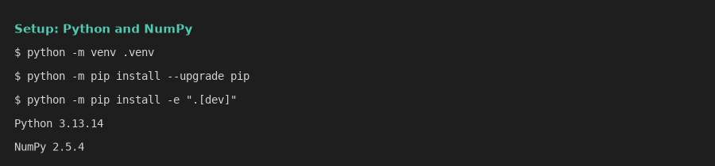

## ▶️ Run

```bash
python -m computing_with_numpy
jupyter lab notebooks/computing_with_numpy.ipynb
python scripts/make_screenshots.py   # rebuilds the notebook and the screenshots
```

The first command prints every lecture step; the last one rewrites the screenshots in `docs/images/`. Charts are saved to files, so no window opens.

## 🧪 Tests

```bash
python -m pytest
ruff check .
ruff format --check .
mypy src
```

Run the static scan with opengrep before every push (`~\.opengrep\cli\latest\opengrep.exe` on Windows):

```bash
bash scripts/check-opengrep.sh
```

```powershell
.\scripts\check-opengrep.ps1
```

## 🖼️ Lecture steps

Every screenshot is the real output of a notebook cell: `python scripts/make_screenshots.py` builds and runs `notebooks/computing_with_numpy.ipynb` and rewrites `docs/images/`.

### Part 1: NumPy's ndarray

Module `computing_with_numpy.domain.ndarray_basics`.

| Lecture step | Function |
| --- | --- |
| 1 dimension | `create_vector`, `describe_array`, `vector_element` |
| 2 dimensions | `create_matrix`, `matrix_element`, `matrix_row` |
| Mystery array challenge | `mystery_array`, `mystery_value_18`, `mystery_last_row_vector`, `mystery_first_elements_matrix` |

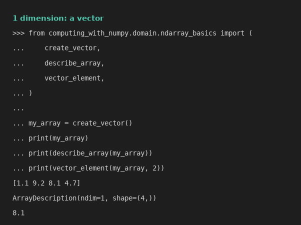

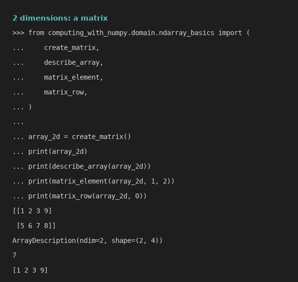

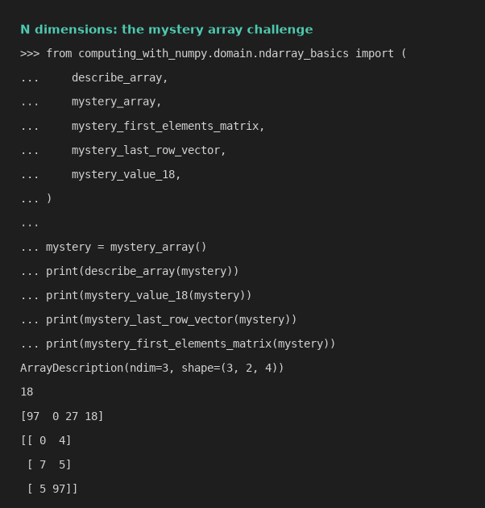

### Part 2: Generating and manipulating ndarrays

Module `computing_with_numpy.domain.generating`; the chart and the image are saved by `computing_with_numpy.infrastructure.screenshots`.

| Challenge | Function |
| --- | --- |
| 1 `arange` | `create_range_vector` |
| 2 slicing | `last_three`, `fourth_to_sixth`, `all_except_first_twelve`, `every_second` |
| 3 reverse | `reverse_array`, `reverse_array_with_flip` |
| 4 non-zero indices | `nonzero_indices` |
| 5 random 3x3x3 | `random_cube` |
| 6 `linspace` x | `linspace_x` |
| 7 `linspace` y and line chart | `linspace_y`, `plot_line` |
| 8 noise image | `noise_image`, `save_noise_image` |

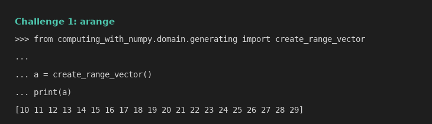

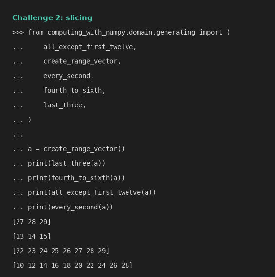

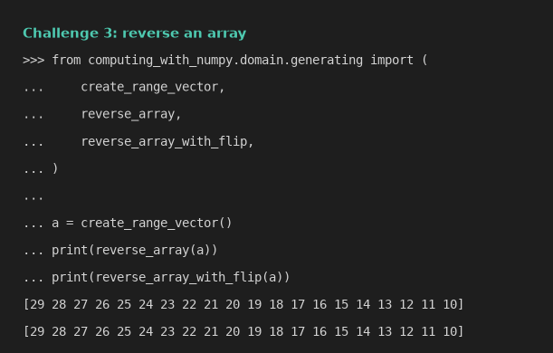

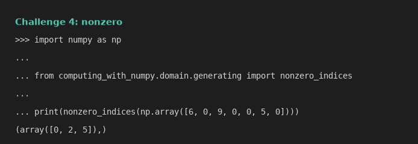

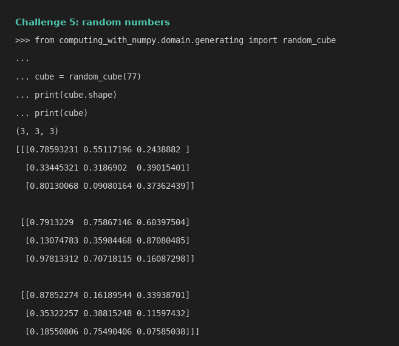

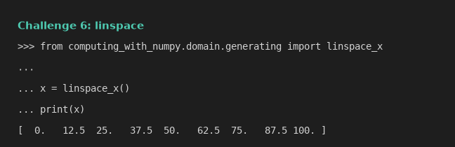

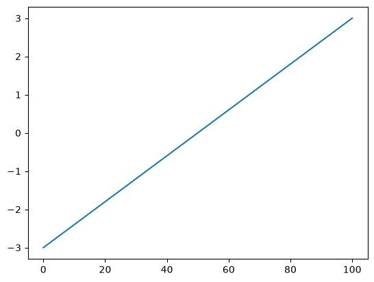

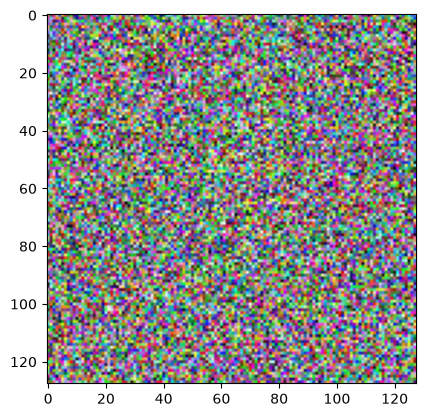

### Part 3: Broadcasting, scalars and matrix multiplication

Module `computing_with_numpy.domain.linear_algebra`.

| Lecture step | Function |
| --- | --- |
| Vector arithmetic | `add_vectors`, `multiply_vectors` |
| Lists versus arrays | `add_lists`, `multiply_lists` |
| Broadcasting a scalar | `scale_array` |
| Matrix multiplication challenge | `matrix_product` (`create_matrix_a1`, `create_matrix_b1`) |

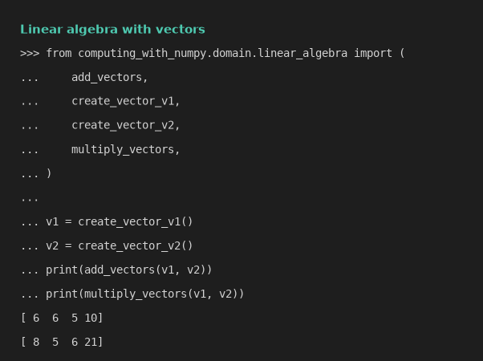

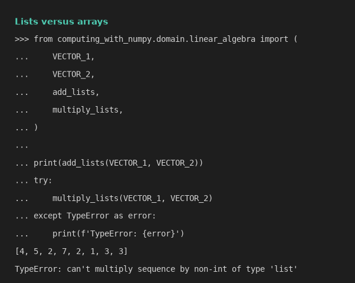

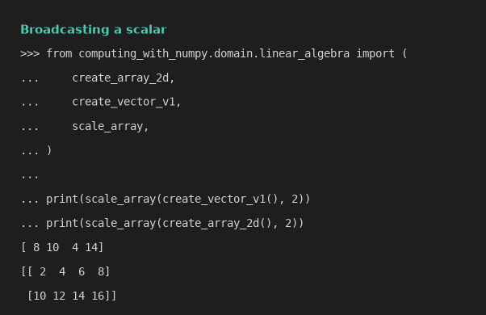

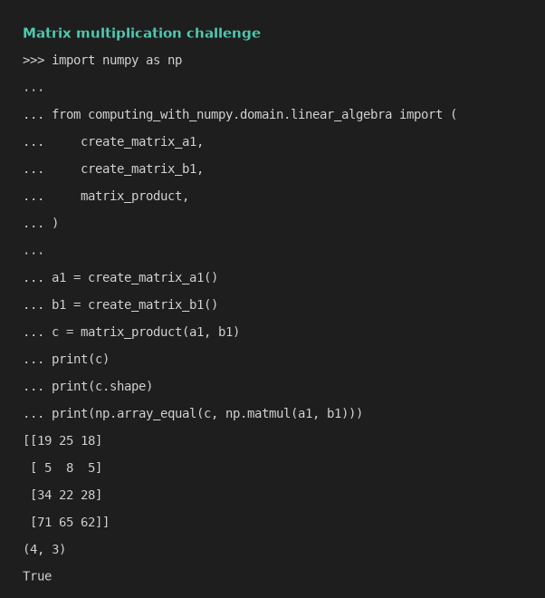

## 📄 License

GNU Affero General Public License v3, see [LICENSE](./LICENSE).

## 🔗 Links

- [Repository][repository]
- [Wiki][documentation]
- [Issue tracker][issues]

## 📎 Appendix: Project documents

| Document | What it tells you |
| --- | --- |
| [AGENTS.md][agents] | The rules AI agents follow in this repository |
| [Business Case][BC-001] | Why the project exists, its scope and success criteria |
| [Stakeholder Analysis][SA-001] | Who is involved; the stakeholder IDs used for owners and reviewers |
| [Project Plan][PP-001] | The gateways and their schedule |
| [Milestones][milestones] | One document per gateway: Go/No-Go criteria and tasks |
| [Artifact registry][registry] | Where each artifact type lives, the next version, the PO language and domain |
| [Traceability matrix][TM-001] | How the artifacts link and when each was last reviewed |
| [Framework README][framework-readme] | The framework this project uses |
| [Framework changelog][framework-changelog] | What changed in each framework release |

---

[repository]: https://git.tirsystem.com/Tirsvad-Udemy-100-days-of-code/077-computing-with-numpy
[documentation]: https://git.tirsystem.com/Tirsvad-Udemy-100-days-of-code/077-computing-with-numpy/wiki
[issues]: https://git.tirsystem.com/Tirsvad-Udemy-100-days-of-code/077-computing-with-numpy/issues
[agents]: ./AGENTS.md
[BC-001]: ./docs/business-case.md
[SA-001]: ./docs/stakeholder-analysis.md
[PP-001]: ./docs/project-plan.md
[milestones]: ./docs/milestones/
[registry]: ./docs/artifact-registry.md
[TM-001]: ./docs/sqa/traceability-matrix.md
[framework-readme]: ./framework/README.md
[framework-changelog]: ./framework/CHANGELOG.md
