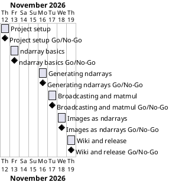

# Project Plan

## Metadata
| Key | Value |
| --- | --- |
| ID | PP-001 |
| CrossReference | [BC-001], [SA-001], [MIL-001], [MIL-002], [MIL-003], [MIL-004], [MIL-005], [MIL-006] |
| Language | en |
| Domain | it |

## Version History
| Date | Status | Author | Reviewer | Change | Commit |
| --- | --- | --- | --- | --- | --- |
| 2026-11-12 | Accepted | Jens Tirsvad Nielsen | S01 | Initial version | pending |

---


## Purpose

Schedules the six gateways that deliver the Day 77 NumPy repository over the six-working-day duration constraint of [BC-001].

## Planning Assumptions

- Week 1 starts 2026-11-12; the plan ends by 2026-11-19, per [BC-001].
- Phase length: one working day per gateway; the weekend of 2026-11-14 and 2026-11-15 falls between MIL-002 and MIL-003.
- One branch and one pull request per milestone; S01 is owner and reviewer, the AI stands in for S01 in autonomous mode and records it ([SA-001]).

## Gateway Schedule

| Gateway | Document | Window | Decision date | Owner | Stories | Main deliverable | Milestone |
| --- | --- | --- | --- | --- | --- | --- | --- |
| Project setup | [MIL-001] | 2026-11-12 | 2026-11-12 | S01 | none | Packaging, layout, README, tooling, host metadata | |
| ndarray basics | [MIL-002] | 2026-11-13 | 2026-11-13 | S01 | none | Module, tests, notebook and screenshots for 1D/2D/N-D arrays | |
| Generating ndarrays | [MIL-003] | 2026-11-16 | 2026-11-16 | S01 | none | Challenges 1 to 8 with tests and screenshots | |
| Broadcasting and matmul | [MIL-004] | 2026-11-17 | 2026-11-17 | S01 | none | Vector math, broadcasting, matrix product | |
| Images as ndarrays | [MIL-005] | 2026-11-18 | 2026-11-18 | S01 | none | Grayscale, flip, rotate, invert, own image, ADR | |
| Wiki and release | [MIL-006] | 2026-11-19 | 2026-11-19 | S01 | none | Wiki in en, da, ms; final README; v1.0.0 | |



## Scope Coverage

| Business Case scope item | Gateway |
| --- | --- |
| Project foundation, README, tooling, host metadata | MIL-001 |
| ndarray basics | MIL-002 |
| Challenges 1 to 8 | MIL-003 |
| Broadcasting and matrix multiplication | MIL-004 |
| Images as ndarrays | MIL-005 |
| Wiki in en, da, ms and screenshots | MIL-006 (screenshots are made in each of MIL-002 to MIL-005) |

## Dependencies

```
MIL-001 → MIL-002 → MIL-003 → MIL-004 → MIL-005 → MIL-006
```

A No-Go on a gateway moves every later date by the days needed for the fix.

## Plan Risks

| Risk | Impact | Mitigation |
| --- | --- | --- |
| Review or CI fixes take longer than a day | Later gateways slip | The final gateway has no fixed dependency on the date; the end date moves, scope does not |
| The image source decision in MIL-005 is blocked | MIL-005 slips | Fall back to a generated stand-in image and record it in the ADR |

## Open Issues

- Permission to download the lecture zip (the signed link in the assignment) is needed from S01 before MIL-005.
- Whether SciPy may be a runtime dependency is decided in the ADR of MIL-005.

---

[MIL-001]: ./milestones/mil-001-project-setup.md
[MIL-002]: ./milestones/mil-002-ndarray-basics.md
[MIL-003]: ./milestones/mil-003-generating-ndarrays.md
[MIL-004]: ./milestones/mil-004-broadcasting-matmul.md
[MIL-005]: ./milestones/mil-005-images-as-ndarrays.md
[MIL-006]: ./milestones/mil-006-wiki-and-release.md
[BC-001]: ./business-case.md
[SA-001]: ./stakeholder-analysis.md
